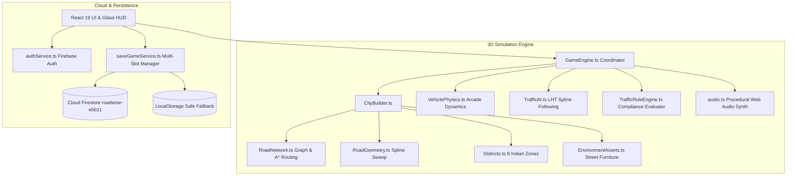

<div align="center">

# 🛵 ROADWISE
### **Next-Gen 3D Indian Motorcycle Delivery & Traffic Rules Simulator**
*Learn Indian Traffic Rules, Master Left-Hand Traffic (LHT), Deliver Orders & Upgrade Your Fleet.*

<br/>

[](https://github.com/karthibaraniofficial-wq/ROADWISE-GAME)
[](file:///e:/game%20road%20game/REGRESSION_TESTS.md)
[](https://threejs.org/)
[](https://react.dev/)
[](https://www.typescriptlang.org/)
[](https://firebase.google.com/)

<br/>

<p align="center">
  <a href="https://github.com/karthibaraniofficial-wq/ROADWISE-GAME"><b>[ 🎮 GitHub Repository ]</b></a>
  &nbsp;&bull;&nbsp;
  <a href="https://karthi-portfolio-delta.vercel.app"><b>[ 🌐 Developer Portfolio ]</b></a>
  &nbsp;&bull;&nbsp;
  <a href="https://github.com/karthibaraniofficial-wq"><b>[ 👨‍💻 Karthikeyan M ]</b></a>
</p>

</div>

---

## 📑 Table of Contents
1. [Executive Overview](#-executive-overview)
2. [Key Gameplay Features](#-key-gameplay-features)
3. [The 8 Metropolitan Districts](#-the-8-metropolitan-districts)
4. [Traffic Rule Engine & Educational Compliance](#-traffic-rule-engine--educational-compliance)
5. [Vehicle Fleet & Customization](#-vehicle-fleet--customization)
6. [Driving Controls & Camera Perspectives](#-driving-controls--camera-perspectives)
7. [System Architecture (Mermaid)](#-system-architecture)
8. [Firebase Authentication & Multi-Slot Saves](#-firebase-authentication--multi-slot-saves)
9. [Installation & Local Setup](#-installation--local-setup)
10. [Automated Testing & Build Pipeline](#-automated-testing--build-pipeline)
11. [Vercel Deployment Guide](#-vercel-deployment-guide)
12. [Project Directory Structure](#-project-directory-structure)
13. [Contributing & Security](#-contributing--security)
14. [Author & Links](#-author--links)

---

## 🌟 Executive Overview
**ROADWISE** transforms defensive driving education into a thrilling, browser-native 3D motorcycle simulation game set in a bustling, procedural Indian metropolis. 

Operating under authentic **Left-Hand Traffic (LHT)** conventions, players start with a modest 110cc scooter, taking on time-sensitive food and parcel delivery orders across **8 distinct architectural districts**. Players must navigate curved arterial corridors, multi-lane roundabouts, elevated highway flyovers, and narrow market alleys while complying with real-world Indian traffic laws (helmet safety, stop line compliance, school zone limits, and emergency vehicle yielding).

---

## 🎮 Key Gameplay Features
- **Procedural Curved Road Network**: Powered by Catmull-Rom parametric splines with continuous asphalt ribbons, sidewalks, curbs, multi-lane dividers, and elevated flyovers ($Y = 4.5\text{m}$).
- **Tactical Navigation & A\* Pathfinding**: Real-time legal route calculation that routes around one-way streets, closed alleys, and congestion, displaying dynamic waypoints, road distance ($m$), and ETA ($s$).
- **Expandable 8-District Tactical Map**: Full-screen blueprint modal (`[M]` key) with landmark badges, district speed limits, and live player telemetry.
- **Dynamic AI Traffic & Emergency Vehicles**: Autorickshaws, hatchback cars, sedans, and emergency ambulances with pulsating lightbars that travel along road curves and stop at traffic lights.
- **Arcade Motorcycle Dynamics**: Progressive acceleration and braking, natural leaning dynamics, reverse gear orientation inversion, and wet monsoon road friction scaling.
- **100% Procedural Web Audio Synth**: Custom synthesized engine RPM frequencies, brake squeals, horn blasts, emergency siren modulations, and monsoon rain noise without loading external audio assets.
- **Multi-Slot Cloud Persistence**: Seamless Firebase Authentication (Email/Password, Google Sign-in, Phone OTP) with multi-slot Cloud Firestore saves and local offline fallback.

---

## 🏙️ The 8 Metropolitan Districts

| # | District Name | Speed Limit | Road Infrastructure | Architectural Highlights |
|---|---|---|---|---|
| **1** | **Commercial Market** | **40 km/h** | 4-Lane Arterial (MG Road) | Strip malls, roadside tea stalls, shopfront awnings, delivery hubs |
| **2** | **Residential Colony** | **40 km/h** | 2-Lane Residential Streets | Green Valley villas, apartment blocks, private compound walls |
| **3** | **IT Park Hub** | **45 km/h** | 16m Multi-Lane Roundabout | Modern glass office towers, tech campus parking, landscaped grounds |
| **4** | **School Zone** | **30 km/h** | 2-Lane School Corridor | Vidya Mandir campus, clock tower, school gate, crossing guards |
| **5** | **Hospital District** | **30–40 km/h** | Priority Emergency Bay | Sanjeevani Multi-Specialty Hospital, emergency vehicle turn-ins |
| **6** | **Industrial Zone** | **35–40 km/h** | Heavy Freight Service Roads | Corrugated metal warehouses, stacked shipping containers, gantry crane |
| **7** | **Heritage Quarter** | **25 km/h** | Narrow Winding Alleys (One-Way) | Traditional Red Fort sandstone temple gopuram, Kalash spire, stone arch |
| **8** | **Ring Road Highway** | **50–60 km/h** | 4-Lane Divided Carriageway | Elevated flyover bridge ($Y = 4.5\text{m}$), steel guardrails, speed bypass |

---

## 🚦 Traffic Rule Engine & Educational Compliance

The centralized `TrafficRuleEngine.ts` monitors high-frequency telemetry at 60 FPS to encourage defensive driving:

| Rule Code | Violation Description | Compliance Condition | Points Penalty | Fine (INR) |
|---|---|---|---|---|
| `RULE_HELMET` | Mandatory Helmet Law | Speed $> 15\text{ km/h}$ with helmet unbuckled | **-30 pts** | **₹100** |
| `RULE_SPEEDING` | Excessive Speed Violation | Traveling $> 2\text{ km/h}$ above posted district limit | **-50 pts** | **₹200** |
| `RULE_RED_LIGHT` | Signal Non-Compliance | Crossing stop line while signal is RED | **-100 pts** | **₹500** |
| `RULE_STOP_LINE` | Stop Line Overhang | Front wheel stopped past marked white junction line | **-20 pts** | **₹50** |
| `RULE_EMERGENCY_YIELD` | Ambulance Yield Failure | Failing to pull over to left when ambulance approaches | **-80 pts** | **₹300** |
| `RULE_WRONG_WAY` | One-Way Alley Violation | Entering one-way roads against legal flow | **-60 pts** | **₹250** |
| `RULE_SAFE_STOP` | Patient Signal Compliance | Stopping safely behind line during RED signal | **+25 pts BONUS** | **Reward** |

---

## 🏍️ Vehicle Fleet & Customization

| Vehicle Model | Category | Top Speed | Acceleration | Handling | Wet Grip | Price |
|---|---|---|---|---|---|---|
| **Scooty 110** | Starter Scooter | $65\text{ km/h}$ | $3.8\text{ m/s}^2$ | High | Moderate | **Starter** |
| **Tork 125** | Heavy Cargo | $80\text{ km/h}$ | $4.5\text{ m/s}^2$ | Good | High | **₹1,200** |
| **Pulsar 150** | Sport Commuter | $95\text{ km/h}$ | $5.5\text{ m/s}^2$ | Agile | Very High | **₹2,800** |
| **Ather Apex** | Electric Pro | $110\text{ km/h}$ | $7.0\text{ m/s}^2$ | Extreme | Maximum | **₹5,500** |

Each vehicle supports **3 Upgrade Stages** (Engine Tuning, Disc/ABS Brakes, Monsoon Tires) and **6 Premium Factory Color Finishes**.

---

## 🕹️ Driving Controls & Camera Perspectives

### Desktop Keyboard Controls
- **Accelerate / Throttle**: `[W]` or `[↑ Up Arrow]`
- **Brake / Reverse**: `[S]` or `[↓ Down Arrow]`
- **Steer Left / Right**: `[A]` / `[D]` or `[←]` / `[→]`
- **Emergency Handbrake**: `[Spacebar]`
- **Fasten / Unbuckle Helmet**: `[H]`
- **Sound Horn**: `[E]` or `[Space]`
- **Cycle Camera Perspective**: `[C]` *(Chase View $\to$ Cockpit / Handlebar $\to$ Tactical Top-Down)*
- **Toggle Tactical City Map**: `[M]` *(Opens 8-District Blueprint)*
- **Pause Simulation**: `[Esc]` or `[P]`

### Touch & Mobile Controls
ROADWISE includes a responsive virtual touch controller with large touch targets ($\ge 48\text{px}$) for smartphones and tablets.

---

## 📐 System Architecture



---

## ☁️ Firebase Authentication & Multi-Slot Saves
- **Project ID**: `roadwise-e5b11`
- **Supported Methods**:
  - Email / Password with format validation
  - Google Sign-In with popup provider
  - Phone OTP Authentication with invisible reCAPTCHA
- **Security Rules**: Deployed with strict tenant boundary enforcement:
  ```javascript
  match /users/{userId}/gameSaves/{saveId} {
    allow read, write: if request.auth != null && request.auth.uid == userId;
  }
  ```

---

## 🚀 Installation & Local Setup

### Prerequisites
- Node.js `v20.x` or `v22.x+`
- npm `v10.x+`

### Setup Instructions
```bash
# 1. Clone the repository
git clone https://github.com/karthibaraniofficial-wq/ROADWISE-GAME.git
cd ROADWISE-GAME

# 2. Install dependencies
npm install

# 3. Configure environment variables (Optional, defaults to offline mode)
cp .env.example .env

# 4. Start the development server
npm run dev
# -> Running on http://localhost:5173/ with zero-latency hot reload
```

---

## 🧪 Automated Testing & Build Pipeline

ROADWISE includes an automated test runner executing **16 comprehensive test suites**:

```bash
# Run the complete test suite
npm test

# Output:
# ✔ 1. Traffic Rule Engine: Helmet Compliance
# ✔ 2. Traffic Rule Engine: Speed Limit Enforcement
# ✔ 3. Traffic Rule Engine: Red-Light Violation & False Penalty Prevention
# ✔ 4. Traffic Rule Engine: Safe Stop Compliance Reward
# ✔ 5. Traffic Rule Engine: Cooldown & Deduplication
# ✔ 6. Vehicle Roster & Upgrade Scaling
# ✔ 7. License Grade Progression
# ✔ 8. Delivery Missions Integrity (All 10 Missions)
# ✔ 9. Authentication: Error Code Formatting & Validation
# ✔ 10. Multi-Slot Save Management & Negative Balance Protection
# ✔ 11. Vehicle Physics: Distinct Braking & Drift Elimination
# ✔ 12. Firebase Configuration Helper Validation
# ✔ 13. Connected Road Network: Nodes, Edges & Districts
# ✔ 14. Navigation Graph: A* Pathfinding Between Districts & One-Way Respect
# ✔ 15. Mission Reachability: All 10 Delivery Missions Reachable Via Road Graph
# ✔ 16. Tactical Navigation Map: Telemetry & Landmark Routing Integrity
# ℹ tests 16 | pass 16 | fail 0 | duration_ms ~500ms
```

### Production Build
```bash
# Compile optimized production bundle
npm run build

# -> Output generated in dist/
# -> dist/bundle.js (1.5 MB uncompressed, ~380 KB gzip)
# -> dist/index.html (Single Page App Entry)
```

---

## 🌐 Vercel Deployment Guide
ROADWISE is fully optimized for one-click deployment to **Vercel Edge Cloud**:

1. Link your repository on [Vercel](https://vercel.com).
2. Set Framework Preset to **Other** (uses `vercel.json`).
3. Set Build Command: `npm run build`
4. Set Output Directory: `dist`
5. Add public Firebase frontend environment variables if syncing with production Firestore.

---

## 📂 Project Directory Structure
```
roadwise/
├── .github/workflows/ci.yml       # GitHub Actions Continuous Integration
├── src/
│   ├── components/                # React UI Components
│   │   ├── AuthModal.tsx          # Login, Register, Phone OTP & Reset Modal
│   │   ├── DeliveryBoard.tsx      # Contracts & Mission Selector
│   │   ├── Garage.tsx             # Showroom, Upgrades & Paint Shop
│   │   ├── HUD.tsx                # Glassmorphic Heads-Up Display
│   │   ├── Minimap.tsx            # Radar & Tactical Full Map Modal
│   │   ├── PlayerDashboard.tsx    # Multi-Slot Saves & Career Profile
│   │   └── TouchControls.tsx      # Virtual Mobile Controls
│   ├── engine/                    # 3D Simulation Engine
│   │   ├── world/                 # Procedural World Architecture
│   │   │   ├── RoadNetwork.ts     # Graph Topology, Catmull-Rom & A*
│   │   │   ├── RoadGeometry.ts    # 3D Mesh Sweeping, Curbs & Bridges
│   │   │   ├── Districts.ts       # 8 Distinct Indian Metropolitan Zones
│   │   │   └── EnvironmentAssets.ts # Streetlights, Trees & Barricades
│   │   ├── CityBuilder.ts         # Master World Orchestrator
│   │   ├── GameEngine.ts          # Master 60 FPS Render Loop
│   │   ├── MissionManager.ts      # 10 Delivery Contracts & Twists
│   │   ├── TrafficAI.ts           # Curved Spline Traffic & Ambulances
│   │   ├── TrafficRuleEngine.ts   # Rule Evaluator & Cooldown Manager
│   │   └── VehiclePhysics.ts      # Arcade Grip & Collision Solver
│   ├── services/                  # Audio Synth & Persistence Services
│   │   ├── audio.ts               # Procedural Web Audio Synthesizer
│   │   ├── authService.ts         # Firebase Authentication Methods
│   │   └── saveGameService.ts     # Multi-Slot Cloud Firestore Saves
│   └── types/game.ts              # Master TypeScript Interfaces
├── firestore.rules                # Production Firestore Security Rules
├── vercel.json                    # Vercel SPA Routing & Security Headers
├── ELITE_ROADMAP.md               # Technical Roadmap & Milestone Matrix
├── WORLD_GENERATION_SPEC.md       # Procedural Math & District Breakdown
├── PERFORMANCE_BUDGET.md          # 60 FPS Profiling & Memory Budgets
├── REGRESSION_TESTS.md            # Automated Test Documentation
└── RELEASE_REPORT.md              # Final Release & Audit Summary
```

---

## 🔒 Contributing & Security
- Please review [CONTRIBUTING.md](file:///e:/game%20road%20game/CONTRIBUTING.md) for pull request guidelines and development standards.
- For vulnerability disclosures, review [SECURITY.md](file:///e:/game%20road%20game/SECURITY.md).

---

## 👨‍💻 Author & Links
**Karthikeyan M**  
*Full-Stack Engineer & 3D Interactive Systems Architect*  
- **GitHub**: [@karthibaraniofficial-wq](https://github.com/karthibaraniofficial-wq)  
- **Portfolio**: [karthi-portfolio-delta.vercel.app](https://karthi-portfolio-delta.vercel.app)  
- **Email**: [karthibaraniofficial@gmail.com](mailto:karthibaraniofficial@gmail.com)
